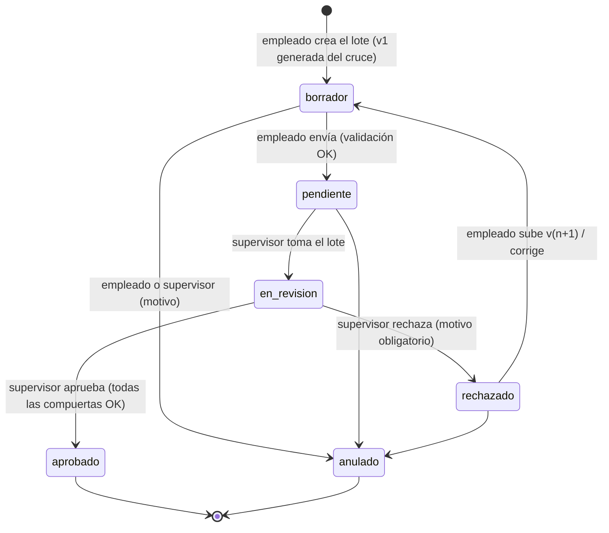
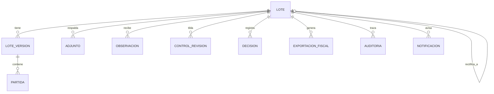

# Módulo de Conciliación y Revisión (Maker-Checker) — Diseño

Estado: **implementado** (backend `app/services/lotes.py`, front `features/revision`) · Reemplaza a la bandeja de revisión anterior
(`backend/app/services/revisiones.py`, índice JSON en `datos/revisiones`).

## 0. Punto de partida y decisiones

| Tema | Hoy | Propuesta |
|---|---|---|
| Persistencia | `indice.json` + un `.xlsx` por envío | **SQLite** (`datos/retenciones.db`) + archivos inmutables guardados por hash |
| Identidad | Nombre escrito a mano en el navegador (`localStorage`) | **Login propio**: correo + contraseña (Argon2id), segundo factor TOTP opcional (obligatorio para supervisores si `DOSFA_SUPERVISORES`), token de acceso JWT de 10 min y token de renovación rotativo en cookie HttpOnly. `usuario_actual()` valida el Bearer y relee la cuenta en cada pedido. Detalle en el README («Ingreso y usuarios»). |
| Estados | pendiente → en revisión → observado / aprobado (se puede reabrir y borrar) | Ciclo de **lote** con versiones, rechazo con motivo obligatorio y **aprobado terminal e inmutable** |
| Excel | Hojas `ARCA` y `LIBRO MAYOR` (copia de las planillas originales) | Se mantienen y se agregan `CONCILIACION` (una fila por partida, con estado y código) y `_META` (oculta, para validar la re-subida) |
| Historial | Lista dentro del JSON, editable | Tabla `auditoria` **append-only** con encadenado de hashes (UTC, usuario, IP, acción) |

Roles (los asigna la cuenta principal en «Usuarios»):

- **empleado** (Maker): concilia, arma el lote, justifica, adjunta respaldos, sube versiones, envía y anula lotes no aprobados.
- **supervisor** (Checker): todo lo del empleado, y además toma el lote, tilda controles, observa, rechaza o aprueba, se pasa un lote que tiene otro supervisor y consulta la auditoría completa. **Nunca** revisa un lote donde sea autor de alguna versión.
- La **cuenta principal** (`CUENTA_PRINCIPAL`) y los supervisores que ella habilite gestionan los usuarios.

---

## 1. Ciclo de vida del lote

### 1.1 Estados



`aprobado` y `anulado` son terminales. No hay "reabrir": un error detectado
después de aprobar se corrige con un **lote rectificativo** nuevo que referencia
al anterior (`lote.rectifica_a`), así el aprobado original queda intacto.

### 1.2 Paso a paso

1. **Conciliación (motor).** El empleado importa ARCA + Libro Mayor (o los trae
   con los bots) y corre el cruce. Cada partida sale con estado inicial y código
   de discrepancia (ver §1.3).
2. **Crear lote.** `POST /lotes` con el `task_id` del cruce. Cliente, CUIT y período salen del resumen del cruce (los bots los saben; con archivos subidos a mano solo se conoce el período y el resto se escribe al confirmar). Si ya hay un lote corregible de ese cliente y período, la pantalla pide `regenerar` en vez de crear. Se guarda:
   - la versión **v1** (Excel generado, `origen = generado`, SHA-256);
   - las partidas normalizadas de esa versión;
   - el **snapshot de totales de las fuentes** (total del libro de retenciones del
     período según el Mayor y total informado por ARCA), que es contra lo que se
     cuadra después y que el empleado no puede editar.
   Estado `borrador`. Auditoría: `lote_creado`, `version_generada`.
3. **Trabajo del empleado (borrador).** Por cada partida que no es
   `Conciliado Automático` registra justificación/comentario y, si es un ajuste o
   una diferencia justificada a mano, **adjunta el respaldo** (NC, certificado
   rectificativo, captura del error de carga). Puede descargar el Excel, trabajarlo
   y re-subirlo como **v(n+1)** (pasa por el pipeline de §4) o regenerarlo desde
   un cruce nuevo.
4. **Enviar a revisión.** `POST /lotes/{id}/enviar`. Corre las compuertas de
   envío (validación de la última versión, respaldos obligatorios, cuadre). Si
   alguna falla → 409 con la lista. Si pasan → `pendiente`, notificación a supervisores.
5. **Tomar.** Un supervisor (≠ autor de cualquier versión) hace
   `POST /lotes/{id}/tomar` → `en_revision`, queda asignado como `checker`.
6. **Revisión.** Tilda los controles, revisa adjuntos, deja observaciones por
   partida o generales.
7. **Decisión.**
   - **Rechazar**: `POST /lotes/{id}/rechazar` con `motivo` obligatorio (mín. 15
     caracteres) y observaciones puntuales opcionales por partida (p. ej.
     *"Diferencia no conciliada de $15.000 en certificado N° 4512"*). Vuelve a la
     bandeja del empleado (`rechazado`) con notificación.
   - **Aprobar**: `POST /lotes/{id}/aprobar` con la `version` que vio (bloqueo
     optimista: si se subió otra versión mientras revisaba, 409). Compuertas de
     aprobación (§1.4). Si pasan → `aprobado`.
8. **Cierre.** Al aprobar, en una transacción: se fija `hash_aprobado` (hash de
   versión + partidas + adjuntos), se bloquea el lote (triggers de SQLite, §2.3),
   se registra `lote_aprobado` y se **habilita la exportación fiscal** (TXT/CSV
   para la DDJJ y libro de retenciones), que se genera una vez y queda guardada
   con su hash.

### 1.3 Motor de conciliación: estados y códigos por partida

El cruce actual se conserva (comprobante → CUIT+importe → razón social →
importe+fecha → centavos de diferencia → manual). Encima se calcula el estado
pedido comparando los **cuatro campos clave**: CUIT, N° de certificado, fecha e
importe neto retenido.

| Estado inicial | Regla | Código(s) |
|---|---|---|
| `Conciliado Automático` | Par encontrado y los 4 campos coinciden (fecha dentro de `TOLERANCIA_DIAS`, ver nota) | — |
| `Diferencia de Monto` | Par con CUIT + certificado coincidentes y el importe distinto (incluye el criterio de centavos) | `D01` importe, `D02` base imponible, `D03` alícuota (estos dos solo si la fuente los trae) |
| `Pendiente de Comprobante` | Par encontrado por un criterio débil (sin certificado/documento que coincida, o CUIT distinta, o emparejado a mano) | `P01` sin certificado en el Mayor, `P02` CUIT distinta, `P03` fecha fuera de tolerancia, `P04` par manual |
| `No Localizado en ERP` | Está en ARCA y no en el Mayor (`faltan_en_mayor`) | `N01` |
| `No Localizado en Fisco` | Está en el Mayor del período y no en ARCA (`faltan_en_arca`) | `N02` |

Además, flags de auditoría preliminar por partida: `DUP` (posible duplicado),
`CUIT_INV` (dígito verificador inválido), `FUERA_PER` (fecha fuera del período),
`SUG` (hay una sugerencia de par sin aceptar).

> Nota: la especificación pide fecha exacta. En la práctica el asiento se carga
> con la fecha del cobro, por eso hoy hay tolerancia de días. Propuesta: el par
> con fecha distinta pero dentro de tolerancia sigue siendo `Conciliado
> Automático`, con la diferencia de días visible; fuera de tolerancia → `P03`.

### 1.4 Compuertas

**Para enviar** (empleado) y **para aprobar** (supervisor, se re-evalúan todas):

1. La última versión pasó el pipeline de validación sin errores.
2. Toda partida ≠ `Conciliado Automático` que no esté quitada tiene tipo de
   justificación, texto y **al menos un adjunto**. Una partida quitada solo pide el motivo.
3. **Cuadre al centavo** (con `Decimal`): Σ importe ERP del archivo = total del
   libro de retenciones del período (snapshot) y Σ importe Fisco = total ARCA.
   La diferencia ARCA − Mayor debe quedar explicada por las partidas no
   localizadas y las diferencias de monto (los "motivos de la diferencia" que ya
   calcula el cruce deben sumar exactamente la diferencia).
4. **Diferencia neta en cero**: Σ importe Fisco − Σ (importe ajustado, o importe
   ERP si no hay ajuste), sin las partidas quitadas.

Solo para aprobar:

5. Usuario con rol `supervisor`, distinto de todo autor de versiones del lote (SoD).
   Las versiones de corrección del supervisor (`correccion_checker = 1`) no lo hacen autor.
6. Todos los controles tildados y ninguna observación abierta.
7. La `version` enviada es la vigente.

### 1.5 Correcciones en pantalla

`importe_erp` e `importe_fisco` son las fuentes: no cambian y son las que cuadran
contra los totales. Lo que se corrige va aparte, en `importe_ajustado` (del lado
del Libro Mayor: lo que ARCA informa no se discute) y `excluida`, y queda en la
auditoría, en el Excel y en el sello de la aprobación. No hay alícuotas: las
fuentes no las traen.

El supervisor asignado puede corregir sin devolver el lote. Sobre la versión
sellada, la primera corrección arma la versión siguiente, sin sellar y con
`correccion_checker = 1`: el lote sigue `en_revision`, con los controles ya
tildados. Las correcciones que siguen van sobre esa misma versión, que se sella
al aprobar o devolver. Nadie más revisa lo que corrigió el supervisor: queda el
registro («Editado por», diff entre versiones y auditoría).

---

## 2. Modelo de datos (SQLite)

### 2.1 Diagrama



### 2.2 Tablas

Fechas en UTC ISO-8601. Importes como `TEXT` decimal (`"15000.00"`) para no
perder centavos; se operan con `Decimal`.

**lote**
| Campo | Tipo | Nota |
|---|---|---|
| id | TEXT PK | uuid |
| empresa, cuit_empresa | TEXT | |
| periodo | TEXT | `AAAA-MM` |
| estado | TEXT | `borrador·pendiente·en_revision·rechazado·aprobado·anulado` |
| version_vigente | INTEGER | |
| maker_id, checker_id | TEXT | checker se fija al tomar |
| total_libro_erp, total_fisco | TEXT | snapshot de las fuentes al crear |
| hash_aprobado | TEXT NULL | se fija al aprobar |
| rectifica_a | TEXT NULL FK lote | |
| creado_utc, actualizado_utc, aprobado_utc | TEXT | |
| UNIQUE | | (cuit_empresa, periodo) entre lotes no anulados ni rectificados |

**lote_version**
| Campo | Tipo | Nota |
|---|---|---|
| id | TEXT PK | |
| lote_id | FK | |
| numero | INTEGER | v1, v2… · UNIQUE(lote_id, numero) |
| origen | TEXT | `generado` (del cruce) · `subido` (Excel re-subido) |
| sha256 | TEXT | del archivo; distinto al de la versión anterior |
| ruta_archivo | TEXT | `datos/archivos/<sha256>.xlsx`, solo lectura |
| autor_id | TEXT | |
| resumen_json | TEXT | totales por estado, cuadre |
| validacion_json | TEXT | resultado del pipeline |
| creado_utc | TEXT | |

**partida** (una fila de la hoja `CONCILIACION` por versión)
| Campo | Tipo | Nota |
|---|---|---|
| id | INTEGER PK | |
| version_id | FK | |
| clave | TEXT | estable entre versiones: hash(CUIT, certificado, fecha, importe, lado) |
| estado | TEXT | los 5 de §1.3 |
| codigo, flags | TEXT | `D01`, `["DUP"]` |
| criterio | TEXT | criterio del cruce |
| cuit, razon_social, impuesto, certificado, documento_erp | TEXT | |
| fecha_fisco, fecha_erp | TEXT | |
| importe_fisco, importe_erp, diferencia | TEXT | |
| base_imponible, alicuota | TEXT NULL | si la fuente los trae |
| justificacion | TEXT | `aceptada · ajuste · error_carga · temporal` |
| comentario | TEXT | |
| hash_fila | TEXT | de las columnas bloqueadas, para detectar alteraciones |

**adjunto**: id, lote_id, clave_partida (NULL = del lote), version_id, nombre,
mime, tamaño, sha256, ruta, autor_id, creado_utc, `retirado_utc` (no se borra:
se retira, y solo antes de aprobar).

**observacion**: id, lote_id, version_id, clave_partida NULL, texto, origen
(`nuestro·cliente·arca`), autor_id, creado_utc, resuelta_por, resuelta_utc.

**control_revision**: lote_id, version_id, control, ok, usuario_id, fecha_utc ·
PK(lote_id, version_id, control). Al subir una versión nueva los controles
vuelven a cero.

**decision**: id, lote_id, version_id, tipo (`rechazo·aprobacion·anulacion`),
motivo, usuario_id, fecha_utc.

**exportacion_fiscal**: id, lote_id, tipo (`ddjj_txt·libro_csv·…`), ruta,
sha256, usuario_id, fecha_utc.

**notificacion**: id, destinatario_id NULL, destinatario_rol NULL, lote_id,
tipo, texto, leida_utc, creado_utc.

**auditoria**
| Campo | Tipo | Nota |
|---|---|---|
| id | INTEGER PK AUTOINCREMENT | |
| ts_utc | TEXT | |
| user_id, user_nombre, roles | TEXT | |
| ip_address, user_agent | TEXT | |
| action_type | TEXT | `lote_creado · version_generada · version_subida · carga_rechazada · descarga · adjunto_subido · adjunto_retirado · enviado · tomado · control · observacion · rechazado · aprobado · anulado · exportacion · acceso_denegado` |
| lote_id, version_id | TEXT NULL | |
| detalle_json | TEXT | |
| hash_previo, hash | TEXT | `hash = sha256(hash_previo + fila)`: si alguien toca una fila, la cadena no cierra |

### 2.3 Inmutabilidad

- `auditoria`: triggers `BEFORE UPDATE` / `BEFORE DELETE` → `RAISE(ABORT)`.
  Endpoint de verificación de la cadena.
- Lote aprobado: triggers que abortan cualquier `UPDATE`/`DELETE` sobre `lote`,
  `lote_version`, `partida`, `adjunto`, `observacion`, `control_revision` cuyo
  lote esté en `aprobado`. La API además lo valida antes (mensaje claro); el
  trigger es la red de seguridad.
- Archivos: guardados por hash (mismo contenido = mismo archivo), nunca se
  sobreescriben; al aprobar se marcan solo-lectura. El `hash_aprobado` permite
  comprobar que nada cambió.
- No hay `DELETE` de lotes por API: solo `anular` (con motivo) si no está aprobado.

---

## 3. API REST

Prefijo `/api`. El usuario sale de `usuario_actual()` (token de acceso en `Authorization: Bearer`).
Errores con un formato único:

```json
{ "detail": { "codigo": "COMPUERTA", "mensaje": "No se puede aprobar.",
  "errores": [ { "codigo": "SIN_RESPALDO", "mensaje": "Falta respaldo", "clave": "a1f3…", "fila": 12, "columna": "Justificación" } ] } }
```

`401` sin usuario · `403` rol o SoD · `404` · `409` estado/compuerta/versión
vieja · `413` archivo grande · `422` validación del archivo o del payload.

### Lotes

| Método | Ruta | Rol | Payload mínimo | Respuesta |
|---|---|---|---|---|
| POST | `/lotes` | empleado | `{task_id, empresa, cuit_empresa, periodo, comentario?}` | 201 lote (v1) |
| GET | `/lotes?estado&periodo&empresa&asignado_a_mi` | todos | — | lista con resumen |
| GET | `/lotes/{id}` | todos | — | lote + versión vigente + compuertas (qué falta) |
| POST | `/lotes/{id}/enviar` | empleado (maker) | multipart `version`, `comentario?`, `evidencia*` | lote `pendiente` |
| POST | `/lotes/{id}/tomar` | supervisor | — | lote `en_revision` |
| PUT | `/lotes/{id}/controles/{control}` | supervisor asignado | `{version, ok}` | lote |
| POST | `/lotes/{id}/rechazar` | supervisor asignado | `{version, motivo, observaciones?: [{clave?, texto, origen}]}` | lote `rechazado` |
| POST | `/lotes/{id}/aprobar` | supervisor asignado | multipart `version`, `evidencia*` | lote `aprobado` |
| POST | `/lotes/{id}/anular` | empleado / supervisor | `{motivo}` | lote `anulado` |
| POST | `/lotes/{id}/rectificar` | empleado | `{task_id, motivo}` | 201 lote nuevo que rectifica al aprobado |

### Versiones y diff

| Método | Ruta | Rol | Payload | Respuesta |
|---|---|---|---|---|
| GET | `/lotes/{id}/versiones` | todos | — | lista v1…vn con autor, hash, resumen |
| POST | `/lotes/{id}/versiones` | empleado (borrador/rechazado) | multipart `archivo` **o** `{task_id}` (regenerar) + `version_base` | 201 versión · 422 con errores por fila |
| GET | `/lotes/{id}/versiones/{n}/excel` | todos | — | `.xlsx` (registra `descarga`) |
| GET | `/lotes/{id}/versiones/{n}/validacion` | todos | — | resultado del pipeline |
| GET | `/lotes/{id}/diff?desde=1&hasta=2` | todos | — | `{agregadas, quitadas, cambiadas: [{clave, campo, antes, despues}], totales}` |

`evidencia` son comprobantes (`.pdf`, `.jpg`, `.png`, hasta 5 MB cada uno) que se
guardan como respaldos generales en la misma transacción que la confirmación: si
la compuerta falla no entra ninguno, y al aprobar quedan dentro de `hash_aprobado`.
Cada uno deja su `adjunto_subido` en la auditoría con `origen = evidencia`.

### Partidas y adjuntos

| Método | Ruta | Rol | Payload | Respuesta |
|---|---|---|---|---|
| GET | `/lotes/{id}/partidas?version&estado&codigo` | todos | — | partidas |
| PATCH | `/lotes/{id}/partidas/{clave}` | quien prepara (borrador/rechazado) o supervisor asignado (en_revision) | `{version, justificacion?, comentario?, importe_ajustado?, excluida?}` (`importe_ajustado: null` borra el ajuste) | detalle |
| POST | `/lotes/{id}/adjuntos` | empleado | multipart `archivo`, `clave_partida?` | 201 adjunto |
| GET | `/lotes/{id}/adjuntos/{aid}` | todos | — | archivo (registra `descarga`) |
| DELETE | `/lotes/{id}/adjuntos/{aid}` | empleado, no aprobado | — | 204 (retira, no borra) |

### Observaciones

| Método | Ruta | Rol | Payload |
|---|---|---|---|
| POST | `/lotes/{id}/observaciones` | supervisor asignado | `{version, texto, origen, clave_partida?}` |
| PATCH | `/lotes/{id}/observaciones/{oid}` | supervisor asignado | `{resuelta}` |

### Exportación fiscal (solo `aprobado`)

| Método | Ruta | Payload | Respuesta |
|---|---|---|---|
| POST | `/lotes/{id}/exportaciones` | `{tipo}` | 201 (idempotente: si ya existe, devuelve la misma) |
| GET | `/lotes/{id}/exportaciones` / `/{eid}` | — | lista / archivo |

### Auditoría y notificaciones

| Método | Ruta | Rol |
|---|---|---|
| GET | `/lotes/{id}/auditoria` | todos |
| GET | `/auditoria?desde&hasta&usuario&accion` | supervisor |
| GET | `/auditoria/verificar` | supervisor — recorre la cadena de hashes |
| GET | `/notificaciones` · POST `/notificaciones/{id}/leida` | el destinatario |

Los endpoints actuales `/api/revisiones/*` se retiran; un script de migración
única pasa el `indice.json` existente a lotes (estado equivalente, v1 = el Excel
guardado, historial → auditoría con `user_id` = nombre escrito).

---

## 4. Validación del Excel y control de errores

### 4.1 Formato del archivo generado

- Hojas `ARCA` y `LIBRO MAYOR`: como hoy (papel de trabajo).
- Hoja `CONCILIACION`: una fila por partida — Clave, Estado, Código, Flags,
  Criterio, CUIT, Razón social, Impuesto, Certificado, Documento ERP, Fecha
  Fisco, Fecha ERP, Importe Fisco, Importe ERP, Diferencia, **Justificación**
  (lista desplegable), **Comentario**, Importe ajustado, Excluida.
  Protegida: solo Justificación y Comentario quedan desbloqueadas. Totales al pie
  con fórmulas (bloqueadas).
- Hoja `_META` (muy oculta): lote_id, versión base, fecha de generación, hash de
  cada fila y de los totales, versión del formato.

### 4.2 Pipeline de la re-subida

Etapas en orden. Dentro de cada etapa se **acumulan** todos los errores (no se
corta en el primero) para que el empleado corrija todo de una vez; si una etapa
tiene errores bloqueantes, no se corren las siguientes. Nada se guarda hasta que
todo pasa (transacción); un rechazo se registra en auditoría como
`carga_rechazada` con el detalle.

| # | Etapa | Controles | Severidad |
|---|---|---|---|
| 0 | Transporte | Tamaño ≤ `MAX_MB_ARCHIVO`; extensión `.xlsx` y firma ZIP real; sin macros (`.xlsm`/vbaProject rechazado); SHA-256 distinto al de la versión vigente | error |
| 1 | Estructura | Existen `CONCILIACION` y `_META`; encabezados exactos y en orden; `_META.lote_id` = este lote; `version_base` = vigente (si no: "bajaste v2 y ya hay v3") | error |
| 2 | Sintaxis por fila | CUIT con dígito verificador; fechas válidas y dentro del período (± tolerancia); importes numéricos con 2 decimales; Estado/Código/Justificación dentro del catálogo | error |
| 3 | Integridad | Sin claves duplicadas; mismas claves que la versión base (no se agregan ni quitan filas a mano: eso se hace re-conciliando); `hash_fila` de columnas bloqueadas igual al de `_META` (detecta celdas alteradas aunque se haya quitado la protección); sin fórmulas fuera de las celdas de totales; totales del pie recalculados en el servidor (no se confía en el valor cacheado) | error |
| 4 | Reglas de negocio | Partida ≠ Conciliado Automático sin justificación → error para enviar, advertencia al subir; `ajuste`/diferencia justificada sin adjunto → idem; comentario obligatorio en `Diferencia de Monto` | error / advertencia |
| 5 | Cuadre | Σ ERP = `total_libro_erp` y Σ Fisco = `total_fisco` al centavo (`Decimal`, `ROUND_HALF_EVEN` solo al mostrar); motivos de la diferencia suman la diferencia | error |

Resultado:

```json
{ "valida": false, "etapa_fallida": 3,
  "errores": [ { "etapa": 3, "codigo": "COLUMNA_ALTERADA", "hoja": "CONCILIACION", "fila": 14, "columna": "Importe ERP", "esperado": "15000.00", "encontrado": "1500.00" } ],
  "advertencias": [ … ], "resumen": { "filas": 128, "cuadre_erp": "0.00", "cuadre_fisco": "0.00" } }
```

### 4.3 Otros controles

- **Lectura segura**: `openpyxl` en `read_only`, `data_only=False` para ver las
  fórmulas; límite de filas/columnas; tiempo máximo de proceso. Los archivos se
  procesan desde un temporal y recién se mueven al almacén al aprobar la etapa 5.
- **Concurrencia**: toda acción de escritura lleva la `version` que el usuario
  vio; si no es la vigente → 409. Escrituras de SQLite en transacción
  `BEGIN IMMEDIATE`.
- **Adjuntos**: whitelist de tipos (PDF, imágenes, xlsx), tamaño máximo, hash,
  nombre saneado; se sirven siempre como descarga.
- **Errores inesperados**: se loguean con un id de correlación que se devuelve en
  la respuesta y queda en auditoría; al usuario nunca le llega un traceback.

---

## 5. Implementación propuesta (por etapas)

1. **Base**: SQLite + migraciones simples, `usuario_actual()` (hoy: login propio con tokens),
   auditoría con cadena de hashes y triggers, migración del `indice.json`.
2. **Motor**: estados y códigos por partida en el cruce + hoja `CONCILIACION` y
   `_META` en el Excel.
3. **Lote y máquina de estados**: crear, enviar, tomar, rechazar, aprobar,
   anular; compuertas; SoD; inmutabilidad.
4. **Versiones**: re-subida con el pipeline de §4, regenerar desde un cruce, diff.
5. **Adjuntos, justificaciones y cuadre**.
6. **Exportación fiscal** y notificaciones.
7. **Frontend**: bandeja por rol (mis lotes / para revisar), detalle con
   partidas filtrables, adjuntos, diff entre versiones, línea de tiempo de
   auditoría; selector de usuario de desarrollo hasta integrar el login.

## 6. Pendientes de definir

- ~~Integración del login~~: resuelto con login propio (ver README, «Ingreso y usuarios»). Si más
  adelante la página principal tiene su propio login, se puede reemplazar `usuario_actual()`.
- Formatos exactos de la exportación fiscal (p. ej. SIFERE para IIBB, importación
  de retenciones/percepciones para IVA) y para qué impuestos se generan.
- Si `Conciliado Automático` exige fecha exacta o acepta la tolerancia (§1.3).
- Si la fuente de ARCA trae base imponible y alícuota (si no, `D02`/`D03` no aplican).
